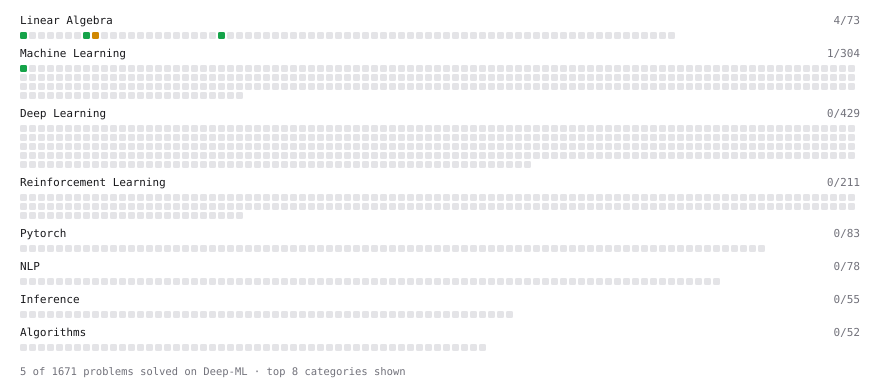

# Deep-ML

My machine learning practice from [Deep-ML](https://www.deep-ml.com). Every solution here was written by hand.

**19** solved · 10 problems · 0 labs · 9 math

[**Browse the interactive portfolio**](https://02tanishq.github.io/deep-ml/) to replay this filling in over time.

## Problems

| | Difficulty | Solved | |
| --- | --- | --- | --- |
| [Calculate 2x2 Matrix Inverse](https://www.deep-ml.com/problems/8) | easy | 2026-10-24 | [solution](problems/0008-calculate-2x2-matrix-inverse) |
| [Calculate R-squared for Regression Analysis](https://www.deep-ml.com/problems/69) | easy | 2026-10-28 | [solution](problems/0069-calculate-r-squared-for-regression-analysis) |
| [Detect Overfitting or Underfitting](https://www.deep-ml.com/problems/86) | easy | 2026-10-28 | [solution](problems/0086-detect-overfitting-or-underfitting) |
| [Implement Orthogonal Projection of a Vector onto a Line](https://www.deep-ml.com/problems/66) | easy | 2026-10-26 | [solution](problems/0066-implement-orthogonal-projection-of-a-vector-onto-a-line) |
| [Linear Regression Using Gradient Descent](https://www.deep-ml.com/problems/15) | easy | 2026-10-26 | [solution](problems/0015-linear-regression-using-gradient-descent) |
| [Linear Regression Using Normal Equation](https://www.deep-ml.com/problems/14) | easy | 2026-10-26 | [solution](problems/0014-linear-regression-using-normal-equation) |
| [Matrix-Vector Dot Product](https://www.deep-ml.com/problems/1) | easy | 2026-10-24 | [solution](problems/0001-matrix-vector-dot-product) |
| [Implement Gradient Descent Variants with MSE Loss](https://www.deep-ml.com/problems/47) | medium | 2026-10-26 | [solution](problems/0047-implement-gradient-descent-variants-with-mse-loss) |
| [Matrix times Matrix ](https://www.deep-ml.com/problems/9) | medium | 2026-10-24 | [solution](problems/0009-matrix-times-matrix) |
| [Numerical Gradient Checking](https://www.deep-ml.com/problems/313) | medium | 2026-10-27 | [solution](problems/0313-numerical-gradient-checking) |

## Math

| | Difficulty | Solved | |
| --- | --- | --- | --- |
| [Derivatives and Gradients](https://www.deep-ml.com/math-problems/1) | easy | 2026-10-26 | [solution](math/0001-derivatives-and-gradients) |
| [Gradient Descent Updates](https://www.deep-ml.com/math-problems/5) | easy | 2026-10-26 | [solution](math/0005-gradient-descent-updates) |
| [ML Workflow Basics](https://www.deep-ml.com/math-problems/30) | easy | 2026-10-27 | [solution](math/0030-ml-workflow-basics) |
| [Bias–Variance Decomposition](https://www.deep-ml.com/math-problems/39) | medium | 2026-10-28 | [solution](math/0039-bias-variance-decomposition) |
| [Inverse and Rank](https://www.deep-ml.com/math-problems/12) | medium | 2026-10-24 | [solution](math/0012-inverse-and-rank) |
| [Least Squares and the Normal Equations](https://www.deep-ml.com/math-problems/34) | medium | 2026-10-26 | [solution](math/0034-least-squares-and-the-normal-equations) |
| [Orthogonality and Projections](https://www.deep-ml.com/math-problems/14) | medium | 2026-10-24 | [solution](math/0014-orthogonality-and-projections) |
| [Regularization and Generalization](https://www.deep-ml.com/math-problems/31) | medium | 2026-10-27 | [solution](math/0031-regularization-and-generalization) |
| [Ridge vs Lasso: Constraint Geometry and Soft-Thresholding](https://www.deep-ml.com/math-problems/94) | hard | 2026-10-30 | [solution](math/0094-ridge-vs-lasso-constraint-geometry-and-soft-thresholding) |

---

_This file is regenerated by Deep-ML on every push._
